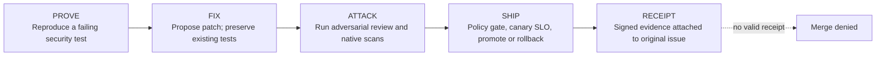

# Sentinel

**Sentinel is a proof-carrying vulnerability remediation engine for GitLab: a patch may ship only when deterministic gates accept a signed Proof Receipt.**

> **Controlled environment:** `target-app/` deliberately pins vulnerable third-party packages for scanner demonstrations. Never deploy that target to production. Sentinel is a hackathon implementation; GitLab platform wiring must be verified against the current Duo Agent Platform release before enabling automation.

## The problem

Dependency scanners find vulnerable packages, but a finding alone does not prove that a specific application path is exploitable or that a proposed patch is safe. Sentinel separates an agent's proposal from deterministic authorization and records the evidence used to decide.

## How Sentinel works in 60 seconds



1. **PROVE** — demonstrate the vulnerable behavior with a test that fails before the patch.
2. **FIX** — propose a patch that makes the proof pass without breaking existing tests.
3. **ATTACK** — review the diff and require native scan evidence.
4. **SHIP** — evaluate measured canary metrics against policy; missing inputs deny promotion.
5. **RECEIPT** — sign and publish the evidence package. A receipt is necessary but not sufficient unless the protected GitLab branch requires the gate job.

The LLM proposes; deterministic code decides. These five verbs are the only workflow stages.

## Autonomy Dial

The policy in `.sentinel/policy.yml` computes the tier per finding. The model cannot select or raise its own tier.

| Tier | Meaning | Policy behavior |
|---|---|---|
| `low` | Hands-off | Eligible patch/minor change only after proof passes and required scans are clean. |
| `medium` | Supervised | Automation may prepare the change; a human approves production. |
| `high` | Assisted | Human approval is required at each step, including major or sensitive-path changes. |

Policy is schema-validated on every CLI run. Invalid policy fails closed. Guardrails include changed-file count, forbidden paths, open-MR cap, two-attempt limit, and the `sentinel-halt` kill-switch label. Gate functions return structured decisions with a reason code and input hash.

## Proof Receipt

A receipt is emitted as `receipt.json`, `receipt.md`, and a self-contained `receipt.html`. JSON is validated against `src/sentinel/receipt.schema.json`; the HMAC-SHA256 signature covers the canonical JSON payload excluding the signature field. A signing key of at least 32 bytes must be provided via a protected CI variable. Use a secret manager or protected CI variable; never put the key in the repository or expose it to an agent.

Example shape (illustrative only; not evidence from a real run):

```json
{
  "schema_version": 1,
  "correlation_id": "example-correlation",
  "idempotency_key": "sha256-of-advisory-package-repository",
  "autonomy_tier": "low",
  "proof": {"before_failed": true, "after_passed": true, "existing_tests_passed": true},
  "scans": [{"scanner": "sast", "status": "clean", "report_digest": "sha256:actual-report-digest"}],
  "decision": {"decision": "deny", "reason_code": "REQUIRED_SCANNER_MISSING", "inputs_hash": "sha256:gate-inputs"},
  "signature": "HMAC-SHA256"
}
```

The promotion gate requires a valid signature, red-then-green proof, passing existing tests, SAST/dependency/secret/container/SBOM evidence, an allow decision, and a promotable canary result. Missing or ambiguous evidence denies. The example intentionally omits full evidence and must not pass the gate.

## Lifecycle coverage

| Lifecycle stage | Implementation |
|---|---|
| plan | `.gitlab/issue_templates/Sentinel.md`; `.gitlab/agents/prove-agent.md` |
| create | `.gitlab/merge_request_templates/Sentinel.md`; `src/sentinel/gitlab_client.py` |
| verify | `src/sentinel/proof.py`, `src/sentinel/gates.py`, pytest suite |
| package | `.gitlab-ci.yml`, `target-app/Dockerfile` |
| secure | GitLab-native SAST, dependency, secret and container scanning jobs; `target-app/CVE-MANIFEST.md` |
| release | `src/sentinel/slo.py`, `src/sentinel/receipt.py`, CI SHIP gate |
| configure | `.sentinel/policy.yml`, `.sentinel/policy.schema.json`, `infra/cloudrun/` |
| monitor | `target-app/load.py`; canary SLO model in `src/sentinel/slo.py` |
| govern | `src/sentinel/audit_log.py`, signed receipt artifacts, `docs/threat-model.md` |

## Safety model

| Threat | Mitigation | Enforcer |
|---|---|---|
| Malicious advisory or poisoned changelog | Treat external prose as untrusted data; hash it; do not execute instructions from it | `triage.py`, agent contract |
| Agent changes/deletes existing tests | Diff gate rejects existing test modifications by default | `gates.py`, policy |
| Token abuse | Project-scoped token, protected CI variables, no production secrets in agent context | CI settings and GitLab adapter |
| Duplicate issues/MRs | Stable advisory+package+repository key and marker lookup | `idempotency.py`, `gitlab_client.py` |
| Runaway retries | Two attempts maximum, then escalate | `orchestrator.py` |
| Excessive change | File cap and forbidden paths | `gates.py` |
| Kill-switch | `sentinel-halt` label must stop the workflow in the platform adapter | policy and adapter contract |
| Missing/ambiguous evidence | Fail-closed decision | `gates.py`, `receipt.py` |
| Supply-chain risk | Native scanners, pinned demo dependencies, explicit applicability notes | GitLab CI and CVE manifest |
| Receipt tampering | HMAC verification before authorization | `proof.py`, `receipt.py`, `cli.py` |

## Quick start (5 steps)

1. Install Python 3.12 and create a virtual environment.
2. Run `python -m pip install -e ".[dev]"`.
3. Run `sentinel check-policy`, `make lint`, `make typecheck`, and `make test` for the Python 3.12 engine suite; run `sentinel triage --advisory CVE-2020-14343 --package PyYAML --repository group/project --change-type major --path target-app/app.py` to inspect deterministic triage output.
4. Run the controlled target tests in a separate Python 3.8 environment after installing `target-app/requirements.txt`; then run `PYTHONPATH=target-app python -m pytest -q target-app/test_app.py`. Do not install the target's legacy pins into the Sentinel engine environment.
5. Add `.sentinel/` and the engine to a separate GitLab repository, configure protected scoped credentials, convert the adapter contracts to the current supported Duo syntax, and test in a non-production project before enabling branch enforcement.

## Install Sentinel on another repository

Copy `src/sentinel/`, `pyproject.toml`, `.sentinel/policy.yml`, `.sentinel/policy.schema.json`, and the CI integration into the target repository. Adjust forbidden paths and thresholds, configure a least-privilege project token as a masked/protected CI variable, and keep production secrets out of agent context. Configure protected branches so the receipt-gate job is required. Do not enable automatic production promotion until the GitLab adapter, real scanner reports, signed receipt and rollback path have been validated in your own project.

GitLab-specific agent/flow/trigger files are thin contracts and each is marked `VERIFY AGAINST CURRENT GITLAB DOCS`. Their exact platform syntax is not claimed as verified. See `docs/ASSUMPTIONS.md`.

## Results

No end-to-end GitLab pipeline or production canary has been run from this archive. Populate this table only with values measured from real pipeline history.

| Metric | Result |
|---|---|
| Distinct dependency findings | `<measured count>` |
| Findings with valid red-then-green proof | `<measured count>` |
| Receipts accepted by signature gate | `<measured count>` |
| Findings escalated to human | `<measured count>` |
| Canary rollback correctly triggered | `<measured yes/no>` |
| Median time to remediation | `<measured duration>` |

## Honest limitations

- GitLab Duo Agent Platform syntax, MCP wiring and trigger event configuration must be checked against current official documentation; the files in `.gitlab/` are adapter contracts, not asserted to be deployable definitions.
- The OSV client uses the documented OSV HTTP API. An MCP client can wrap the same interface; an MCP transport is not bundled as a verified implementation.
- The GitLab REST adapter is implemented but needs a real project/token integration test. It must be exercised with a project-scoped token and rate-limit/error handling appropriate to your instance.
- HMAC is symmetric signing: the verifier needs access to the secret. For stronger separation, integrate a KMS-backed asymmetric signature before production use.
- A signed receipt is not a GitLab merge control by itself. Configure the protected branch and required gate job, then test a deliberately invalid receipt is blocked.
- Canary metrics are models until connected to real telemetry; never supply invented metrics. The demo load script measures HTTP responses but is not a production monitoring system.
- The controlled target contains vulnerable dependencies. Some advisories are not reachable through its public endpoints; Sentinel must escalate rather than fabricate exploit proof.
- Cloud Run infrastructure is included but has not been deployed to a real project.

## License

MIT. See `LICENSE`.
