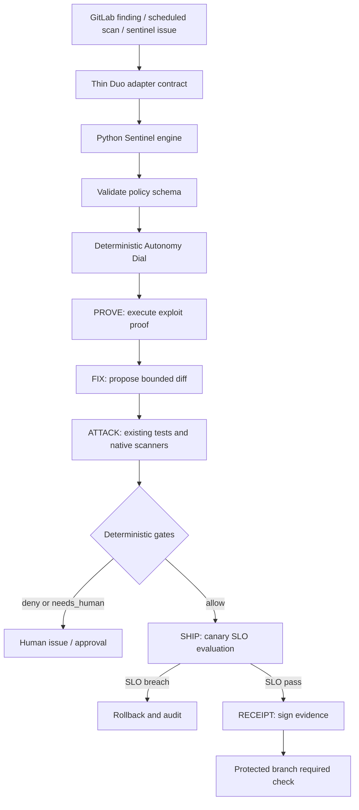

# Architecture and trust boundaries

## Trust boundaries

- **Untrusted input:** advisories, issue bodies, changelogs, scanner output, repository content and agent proposals. They are data, not instructions.
- **Policy boundary:** `.sentinel/policy.yml` is reviewed configuration validated against JSON Schema. Invalid policy blocks execution.
- **Deterministic engine:** pure policy/risk/gate functions return structured decisions with a stable input hash. Agent output is not authorization.
- **Credential boundary:** GitLab tokens and signing keys are masked/protected CI secrets. Production credentials are not injected into agent context.
- **Evidence boundary:** receipt JSON is schema-validated and HMAC-signed. The SHIP gate verifies signature and required evidence. GitLab protected-branch settings must enforce the gate.
- **Deployment boundary:** Cloud Run resources are separate under `infra/cloudrun/`; validate IAM and secret bindings before applying.

## Module-to-verb ownership

| Module | Workflow verb ownership |
|---|---|
| `policy.py`, `risk.py`, `triage.py` | PROVE — validate policy, compute tier and fingerprint untrusted finding text |
| `proof.py` | PROVE and RECEIPT — proof/signature primitives |
| `gates.py` | ATTACK and SHIP — deterministic change, proof and scan decisions |
| `slo.py` | SHIP — threshold evaluation |
| `receipt.py` | RECEIPT — schema validation, signature verification and rendering |
| `gitlab_client.py` | FIX and RECEIPT — idempotent MR/issue actions and receipt note |
| `osv_client.py` | PROVE — advisory lookup input |
| `idempotency.py` | FIX and RECEIPT — stable remediation identity |
| `orchestrator.py` | FIX and ATTACK — bounded retry decision and escalation |
| `audit_log.py` | PROVE, FIX, ATTACK, SHIP and RECEIPT — append-only decision audit |
| `cli.py`, `models.py` | Shared command/model contracts; each emitted decision carries its owning verb |
